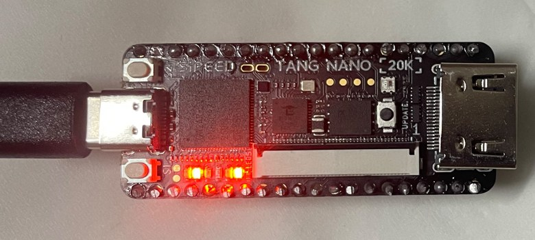
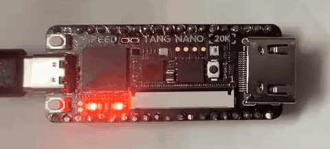
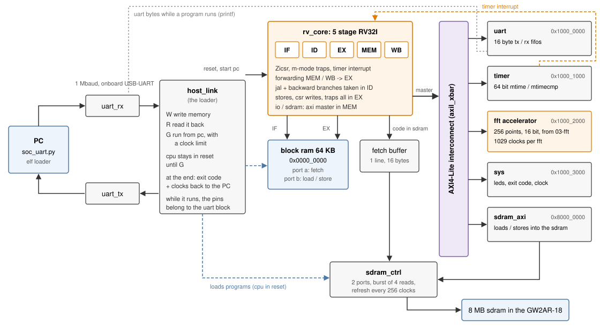
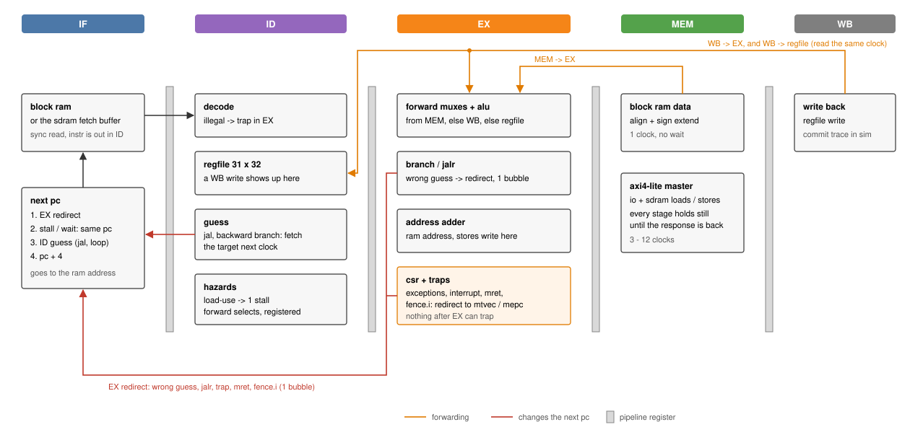
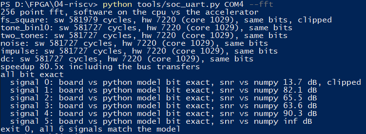

# RISC-V SoC with an FFT accelerator on the Tang Nano 20K

[](https://github.com/Amr-Khaled-Amein/riscv-soc-fpga/actions/workflows/sim.yml)

A 32-bit RISC-V (RV32I) CPU with a 5 stage pipeline, written in Verilog, running on a
Tang Nano 20K (Gowin GW2AR-18). It talks over an AXI4-Lite bus to a UART, a timer,
the 256-point FFT accelerator from my [FFT project](https://github.com/Amr-Khaled-Amein/fft-accelerator-fpga)
and the 8 MB SDRAM inside the FPGA. Programs are C compiled with GCC (or assembly),
loaded over the USB UART.





*Running `sw/leds.c`: LED 5 = CPU running, a dot bounces over LEDs 0-4 on the timer
interrupt (C, with the handler in `crt0.S`).*

- **46 / 46 official RISC-V architectural tests** ([riscv-arch-test](https://github.com/riscv-non-isa/riscv-arch-test) 4.1.0:
  39 RV32I, 6 Zicsr, 1 Zifencei) pass in simulation and on the board
- the FFT accelerator does a 256-point FFT **80.5x faster** than the same fixed point FFT
  in C on the CPU: 7,220 clocks (267 us) vs 581,727 clocks (21.5 ms), counting the time to
  move the samples over the bus. The FFT itself takes 1,029 clocks (565x).
- CPI 1.17 on a small C benchmark (sort, crc32, sieve), every instruction from block RAM
- M-mode CSRs, precise exceptions and the timer interrupt (Zicsr + Zifencei)
- 6,274 logic cells (31%), 3,284 flip-flops, 35 / 46 block RAMs, 2 DSPs. Fmax 39.7 MHz, runs at 27 MHz
- checked against a Python model one instruction at a time, and 29 broken versions of
  the RTL all get caught by the tests

## how it fits together



| address | what | access |
|---|---|---|
| `0x0000_0000` | block RAM, 64 KB, code + data | 1 clock, two ports (fetch, load/store) |
| `0x1000_0000` | UART, 16 byte FIFOs | AXI4-Lite, 5 clocks load / 4 store |
| `0x1000_1000` | timer, 64 bit `mtime` / `mtimecmp`, interrupt | AXI4-Lite |
| `0x1000_2000` | FFT accelerator, 256 points x 16 bit I/Q | AXI4-Lite |
| `0x1000_3000` | sys: LEDs, exit code, clock frequency | AXI4-Lite |
| `0x8000_0000` | SDRAM, 8 MB | AXI4-Lite for data (13 clocks load / 9 store), code through a fetch buffer |

Anything else traps (access fault), right in EX, so it never reaches the bus.

The CPU is the bus master. A load or store to an AXI address leaves the core in MEM and
the whole pipeline waits for the response. The interconnect picks the slave when the
address shows up and keeps it until the response is done. The peripherals use a small
AXI4-Lite front end (`axil_slave.v`) that turns the five channels into a simple
register read / write.

Programs get in through `host_link.v`: while the CPU is held in reset, the PC can write
and read both memories over the UART (1 Mbaud), then start the CPU at any address with
a clock limit. While a program runs the UART pins belong to the UART peripheral, so
`printf`-style output goes straight to the PC. When it writes the exit register the
core stops, the TX FIFO drains, and the exit code + clock count go back.

## the pipeline



| what | handled by | cost |
|---|---|---|
| result needed by the next instruction | forward from MEM | 0 |
| needed 2 instructions later | forward from WB | 0 |
| needed 3 later | register file passes the WB value through | 0 |
| load result needed right away | stall in ID | 1 clock |
| `jal` | target fetched straight from ID | 0 |
| backward branch (a loop) | guessed taken in ID | 0, 1 on the last time round |
| forward branch | guessed not taken | 0 if not taken, 1 if taken |
| `jalr`, trap, `mret`, `fence.i` | redirect from EX | 1 clock |
| load / store to I/O or SDRAM | pipeline frozen until the AXI response | 3 - 12 clocks |

Memory is block RAM with a synchronous read, so IF only puts the next PC on the RAM
address and the instruction comes out at the start of ID. Data addresses come out of
a separate adder in EX for the same reason, and stores write on that clock edge.

Everything that can't be undone happens in EX: stores, CSR writes and traps. Nothing
older than the instruction in EX can still trap, so exceptions are precise without any
extra logic. A trapped instruction carries on to WB as an empty marker, so the
simulation trace shows it in order.

The first build only just made 27 MHz (27.1 MHz, the load address went through the
forwarding compare, the ALU input mux and the ALU). Now the forwarding decisions are
made in ID and registered, so EX only has the muxes, and loads / stores have their own
address adder. The register file is kept in flip-flops: in Gowin's distributed RAM the
timing report started paths at the RAM output, and I wanted the whole path checked.

## the official tests

The tests are the RISC-V International architectural certification tests (ACT4). They
are self-checking: the expected results come from the Sail reference model and are
compiled into each test, which then prints `TEST PASSED` or the first case that failed.
`tests/act4/config/` describes this CPU to the framework (extensions, what goes into
`mtval`, misaligned accesses trap, memory map, how to print and stop).

The biggest one, `I-jal`, is 210 KB (it jumps up to 128 KB away) and the whole GW2AR-18
only has about 92 KB of block RAM. So the tests are linked into the SDRAM at
`0x8000_0000` and the CPU runs them from there (straight line code from SDRAM takes
3.6 clocks per instruction, the fetch buffer holds 4).

```
python tools/soc_uart.py COM4 --act
  I-add-00                     PASS     41470 clocks
  ...
  Zifencei-fence.i-00          PASS     15530 clocks
46/46 passed on the board (75 s)
```

Full output in `docs/board_act.txt`.

## the FFT benchmark

`sw/fft_bench.c` runs the same 256-point fixed point FFT twice on each input: in C on
the CPU, and on the accelerator (write 256 samples, start, wait for done, read 256
bins, all over AXI4-Lite). The C version is the exact algorithm of the hardware
(radix-2, round to nearest, 1/2 per stage, saturate) with the twiddles from the same
generator, so the two have to agree bit for bit. RV32I has no multiply instruction, so
the C code multiplies in software (shift and add, like libgcc).

| signal | software | accelerator, from the CPU | FFT core | same bits | board vs Python model | SNR vs numpy |
|---|---|---|---|---|---|---|
| `fs_square` (clips on purpose) | 581,979 | 7,220 | 1,029 | yes | bit exact, clip flag too | 13.7 dB |
| `tone_bin10` | 581,727 | 7,220 | 1,029 | yes | bit exact | 82.1 dB |
| `two_tones` | 581,727 | 7,220 | 1,029 | yes | bit exact | 65.5 dB |
| `noise` | 581,727 | 7,220 | 1,029 | yes | bit exact | 63.6 dB |
| `impulse` | 581,727 | 7,220 | 1,029 | yes | bit exact | 90.3 dB |
| `dc` | 581,727 | 7,220 | 1,029 | yes | bit exact | exact |

Clocks at 27 MHz, measured on the board with `mcycle`. Over all six:
**80.5x** with the transfers, 565x for the FFT alone. Most of the 7,220 clocks are the
512 AXI accesses, the FFT itself is 14% of it. `soc_uart.py --fft` reads the results
back out of RAM and checks them against `fft_model.py` and `numpy.fft`.



## verification

`tools/run_tests.py` does all of this:

1. `rv_asm.py` (my assembler for the hand written and random tests) gives the same
   words as GCC's assembler for every instruction form
2. the Python model `rv_sim.py` passes the official tests and runs the C programs on its
   own, so matching it means something
3. the SDRAM controller against a model of the SDRAM that checks the command timing
4. directed tests in `tests/asm`: hazards, every trap with `mcause` / `mepc` / `mtval`,
   every peripheral, self modifying code in SDRAM. From block RAM and from SDRAM.
5. random programs: dependent ALU ops on a few registers, loads/stores, loops,
   calls, CSR ops, traps of every kind, I/O, `fence.i`, with timer interrupts in half
   of them, code and data in either memory
6. the 46 official tests
7. the C programs: hello, the benchmark, timer interrupts, the FFT benchmark
8. the whole design through its UART pins (`tb_top.sv`): junk bytes, a command that
   stops halfway, writes and reads in both memories, two runs
9. mutants: the RTL broken on purpose, every one has to make a test fail

In 4 - 7 the testbench writes a line for every instruction that finishes (PC, register
write, store) and `rv_sim.py` steps along it. The first instruction that differs is
reported with the ones before it. Values that only the hardware knows (timer reads,
`mcycle`, `mip`) and interrupts are taken from the trace. In a full run that's 143,557
instructions from the official tests alone.

| mutant | | mutant | |
|---|---|---|---|
| no forwarding from MEM | caught | trapped instruction still writes its register | caught |
| no forwarding from WB | caught | `mscratch` can't be written | caught |
| WB forward wins over MEM | caught | `mepc` not saved on a trap | caught |
| x0 gets forwarded | caught | `mret` doesn't turn interrupts back on | caught |
| no load-use stall | caught | interrupt ignores `mstatus.MIE` | caught |
| register file doesn't pass WB through | caught | `minstret` counts trapped instructions | caught |
| wrong guess on a loop branch not fixed | caught | `fence.i` doesn't refetch | caught |
| `ecall` gives the wrong cause | caught | fetch buffer not cleared by a store to SDRAM | caught |
| `lb` not sign extended | caught | SDRAM read data caught a clock late | caught |
| `sh` always writes the low half | caught | AXI read data from the wrong slave | caught |
| `jalr` doesn't clear bit 0 | caught | interconnect drops the byte strobes | caught |
| `sra` is `srl` | caught | FFT done flag not cleared by start | caught |
| `sltu` is signed | caught | sys block ignores byte strobes | caught |
| misaligned load doesn't trap | caught | loader starts the CPU before the PC is set | caught |
| illegal instruction doesn't trap | caught |  |  |

On the board: the official tests, the directed tests from both memories, the C
programs, and 200 random programs (without timer reads, so the result is fixed) whose
exit code has to match the model (`soc_uart.py COM4 --random 200`).

Two things the board found that the simulation didn't: the first SDRAM model returned
read data one clock late (CAS latency 2 means valid *at* the second edge, so it's
driven after the first), and the controller was tuned to that model. And the loader
let the CPU out of reset on the same clock it set the start address. Both are fixed,
the model follows the datasheet now, and both are in the mutant list.

## running it

Needs Icarus Verilog 12, Python 3 with numpy (+ pyserial for the board), a RISC-V GCC
(`riscv-none-elf-gcc` or `riscv64-unknown-elf-gcc`, only for the C programs) and Gowin
EDA (the free Education version is enough).

```
cd tools
python run_tests.py                     # everything, about 7 min
python run_tests.py --no-mutants        # about 4 min
python build_sw.py                      # c programs -> build/sw/*.elf
```

Build and program:

```
cd soc
gw_sh build.tcl                         # or open soc.gprj in the IDE and Run All
programmer_cli --device GW2AR-18C --run 2 --fsFile impl/pnr/soc.fs
```

On the board (pick your own COM port, `--list` shows them):

```
python tools/soc_uart.py COM4 build/sw/hello.elf      # load an elf, run it, print its output
python tools/soc_uart.py COM4 --act                   # the 46 official tests
python tools/soc_uart.py COM4 --fft                   # fft benchmark, checked against the model
python tools/soc_uart.py COM4 --random 200
python tools/soc_uart.py COM4 build/sw/leds.elf --detach   # led demo, the next command stops it
```

Your own C program: put `foo.c` in `sw/`, `python tools/build_sw.py foo`, then run
`build/sw/foo.elf`. `sw/lib/soc.h` has the register addresses, `lib.c` the printing and
the multiply / divide helpers.

## uart protocol

1,000,000 baud 8N1 (27 MHz / 27, exact). Numbers are big endian.

| PC sends | FPGA answers |
|---|---|
| `P` | `ok` |
| `W` addr(4) len(4) data | `w` + xor of the data |
| `R` addr(4) len(4) | `r` data + xor |
| `G` pc(4) limit(4) | whatever the program prints, then `FF FF 'E'` why(1) code(4) clocks(4) |

`why` is 1 for an exit, 2 if it hit the clock limit. A command that stops halfway for
100 ms is dropped.

LEDs: 0-4 belong to the program (sys LED register), 5 = CPU running.

## layout

```
soc/src/      rtl: rv_core (pipeline), rv_decode, rv_alu, rv_csr, axil_xbar, axil_slave,
              uart_axi, timer_axi, fft_axi (+ fft_core from 03-fft), sys_axi, sdram_axi,
              sdram_ctrl, ram, soc, host_link, top, uart_tx/rx, constraints
sim/          tb_soc (soc + commit trace), tb_top (whole design over uart),
              tb_sdram, sdram_model
sw/           c programs, crt0, link.ld, lib
tests/asm/    directed assembly tests
tests/act4/   the official tests (elfs), the config for this cpu, build.sh
tools/        rv_sim (model), rv_asm, gen_random, run_tests, soc_uart, build_sw, ...
docs/         diagrams, board logs
```

## notes

- Misaligned loads, stores and jump targets trap (allowed by the spec, the tests know
  it from the config). `mtvec` is direct mode only.
- `wfi` is a nop, there's no U or S mode, `mcycle` / `minstret` and the user mode
  `cycle` / `instret` aliases are there, the `time` CSR isn't (read `mtime` instead).
- Gowin gives a PR1014 warning about the clock: pin 4 on this board isn't a dedicated
  clock pin. Timing still has 11.9 ns of slack at 27 MHz.
- The dual port block RAM on this chip can't do read-before-write, so port B is
  write-through. Nothing reads port B in the clock of a write.
- The register file isn't cleared by reset (it doesn't have to be). The simulation
  starts it at 0, so tests have to set every register they read.
- Icarus is slow on this design (about 7,000 clocks a second for the whole SoC), so
  the regression builds the FFT benchmark with one signal and the interrupt test with a
  short tick.
